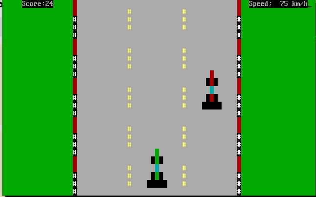
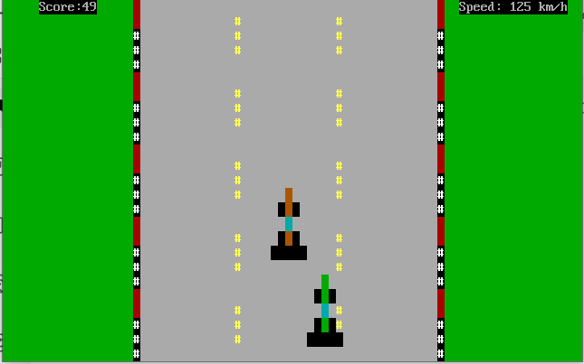
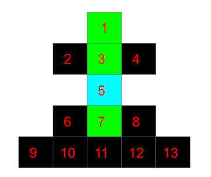
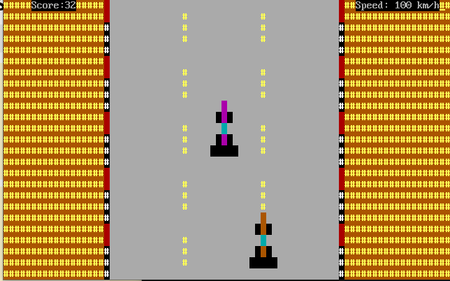
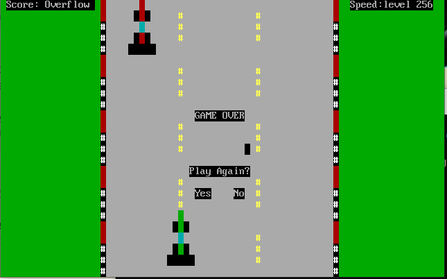
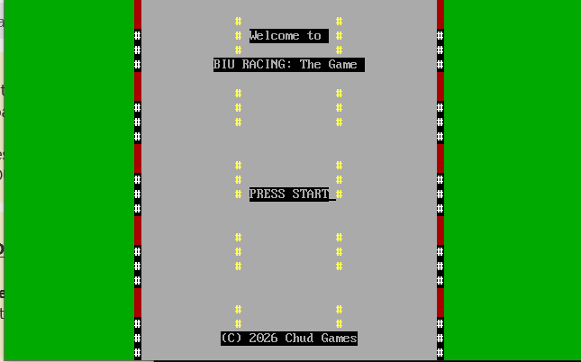
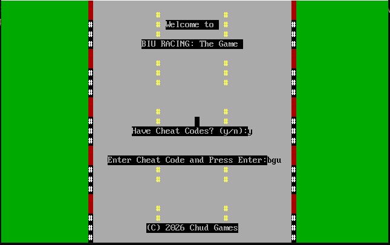
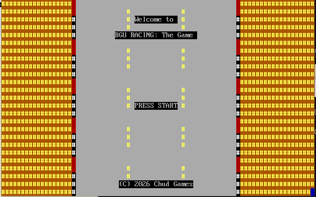
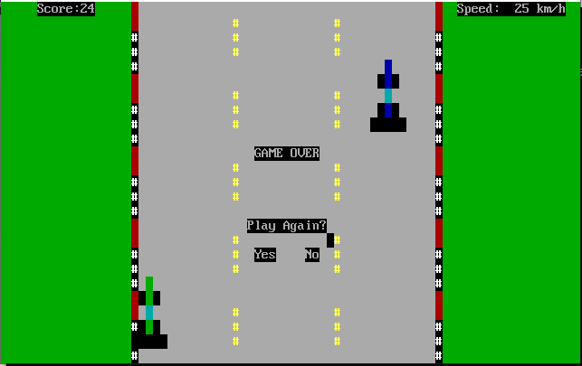
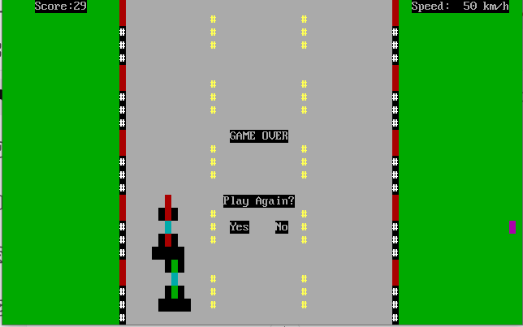

# BIU Racing — 8086 Assembly Racing Game

**A retro-style racing game developed entirely in Intel 8086 Assembly, featuring hardware interrupt handling, direct video memory manipulation, real-time game logic, and collision detection.**

Developed as a final project for the *Microprocessors and Assembly Language* course at Bar-Ilan University.

**Language:** Intel 8086 Assembly (MASM)  
**Environment:** DOS / FreeDOS  
**Development Tools:** Microsoft Macro Assembler (MASM), DOS Emulator  
**Developer:** Yonatan Chudnoff  
**Institution:** Bar-Ilan University — B.Sc. Electrical Engineering

---

## Project Overview

BIU Racing is an interactive, text-mode racing game inspired by my involvement in the Bar-Ilan University Formula Student racing team.

The project was developed entirely in 8086 Assembly, with the goal of applying low-level programming concepts to a complete, interactive application.

Rather than relying on modern graphics engines or high-level programming libraries, the game interacts directly with hardware-related interfaces, including video memory, keyboard and timer interrupts, mouse services, and the real-time clock.

The project integrates several fundamental concepts of computer architecture and embedded programming into a single working system.

### Gameplay Preview



The player controls a racing car, avoids incoming vehicles and track barriers, and earns points for successfully passing opponents. The game includes adjustable speed levels, randomized enemy appearances, collision detection, and interactive menus.

---

## Key Features

- **Real-Time Player Control:** Steer left and right using keyboard input.
- **Adjustable Game Speed:** Five speed levels ranging from 25 to 125 km/h (in-game indicators).
- **Dynamic Opponent Generation:** Enemy positions and colors are selected using real-time clock data.
- **Collision Detection:** Detect collisions between vehicles and track boundaries.
- **Score Tracking:** Earn points based on the selected speed level.
- **Interactive Menus:** Mouse-controlled start, restart, and exit options.
- **Hidden Cheat Code:** Unlock an alternative desert-themed racing environment.
- **Score Overflow Easter Egg:** A special screen inspired by the famous Pac-Man Level 256 overflow phenomenon.

### Gameplay at Different Speeds

| 75 km/h | 125 km/h |
|---|---|
|  |  |

*Speed values represent game difficulty levels rather than actual vehicle velocity.*

---

## Technical Implementation

The project demonstrates several important low-level programming concepts relevant to computer architecture, embedded systems, and hardware-software interaction.

### 1. Hardware Interrupt Handling

Custom interrupt service routines (ISRs) manage keyboard input and game timing.

**Keyboard Interrupt — INT 9h**

- Reads keyboard scan codes directly from I/O port `60h`.
- Processes directional commands and speed adjustments.
- Maintains player input flags for the main game loop.
- Preserves and invokes the original keyboard interrupt handler.

**Timer Interrupt — INT 8h**

- Maintains a software tick counter for game timing.
- Controls enemy movement according to the selected speed level.
- Enables timer-driven gameplay without relying on software delay loops.
- Preserves and invokes the original timer handler.

These mechanisms demonstrate interrupt-driven programming, direct I/O interaction, and coordination between interrupt handlers and application logic.

### 2. Direct Video Memory Manipulation

The game renders its graphics by writing directly to VGA-compatible text-mode video memory at:

`B800h`

Each screen character is represented by a character code and a color attribute.

This approach is used to construct and update:

- Road surfaces and lane markers
- Track boundaries and grass
- Player and enemy vehicles
- Vehicle colors and alternative environments

The rendering routines redraw relevant screen elements as the vehicles move, maintaining a consistent visual representation of the game state.

### 3. Timer-Based Game Logic

Enemy movement is controlled using timer interrupts and a configurable speed level.

The game supports five speed settings, with higher levels requiring fewer timer ticks between enemy movements.

This approach provides predictable movement timing while allowing the player to change difficulty during gameplay.

### 4. Enemy Generation Using the Real-Time Clock

The game uses the system real-time clock (RTC) to introduce variation in enemy appearances.

The implementation:

1. Reads RTC seconds through I/O ports `70h` and `71h`.
2. Converts the retrieved BCD value into decimal.
3. Applies modulo operations to select enemy lanes and colors.
4. Incorporates an additional offset influenced by player movement.

This provides lightweight variation without requiring an external random-number library.

### 5. Collision Detection

Collision detection is implemented through explicit comparisons of vehicle positions stored in video-memory coordinates.

Each vehicle is represented by a collection of character positions. Selected points are calculated relative to the vehicle's reference position and compared against opposing vehicle positions and track boundaries.



*Vehicle position mapping used to implement collision detection.*

The collision system detects both vehicle-to-vehicle and vehicle-to-wall collisions.

### 6. Program Structure and State Management

The game is organized into procedures responsible for initialization, rendering, player movement, enemy movement, collision detection, scoring, and resetting the game.

The main game loop coordinates these operations while maintaining shared game-state variables.

Particular attention was given to:

- Correct interrupt installation and preservation
- Synchronization between timer events and game logic
- Consistent vehicle position updates
- Collision checks before awarding points
- Resetting game state when restarting
- Preserving visual consistency during screen redraws

---

## Game Controls

| Input | Action |
|---|---|
| Left Arrow | Steer left |
| Right Arrow | Steer right |
| F | Increase speed |
| S | Decrease speed |
| Mouse | Navigate menus |
| `bgu` | Activate hidden desert theme at the cheat-code prompt |

---

## Hidden Features and Easter Eggs

### Desert Racing Mode

Entering the hidden cheat code `bgu` activates an alternative racing environment with modified colors and track visuals.



### Score Overflow — Level 256 Tribute

As a tribute to the famous Pac-Man Level 256 bug, the game includes a special end state triggered when the score exceeds 99.

This is an intentionally defined gameplay condition, rather than an actual 16-bit arithmetic overflow.



---

## Game Screens and User Interface

### Welcome Screen



### Cheat Code Entry



### Alternative Title Screen



### Game Over — Wall Collision



### Game Over — Vehicle Collision



---

## Running the Project

### Requirements

- DOS or a compatible DOS emulator
- Microsoft Macro Assembler (MASM) with 8086 support
- An environment supporting DOS interrupts and text-mode video memory

### Compilation

The source code is available in:

`biurace.asm`

Using MASM 6.11, navigate to the directory containing the source file and compile it with:

```dos
ml /Zm biurace.asm
```

The `/Zm` option enables MASM 5.1 compatibility.

After successful compilation and linking, run the generated executable:

```dos
biurace.exe
```

**Note:** The game depends on DOS interrupt services, direct text-mode video memory access, and legacy hardware interfaces. It is intended to run in a compatible DOS environment rather than directly in a modern Windows terminal.

---

## Engineering Challenges and Debugging

Developing the game required debugging several issues involving interrupts, timing, rendering, and shared game state.

| Challenge | Solution |
|---|---|
| Enemy movement stopped after leaving the menu | Reset the timer counter before gameplay and used a greater-than-or-equal timing comparison |
| Player movement temporarily erased the enemy | Updated the rendering sequence to redraw both vehicles |
| Some collisions were not detected | Corrected control flow so all required collision comparisons were evaluated |
| Newly generated enemies had incorrect collision coordinates | Recalculated all relevant enemy positions after spawning |
| Restarting preserved parts of the previous game state | Implemented a reset procedure for gameplay variables and flags |

These challenges reinforced the importance of debugging low-level execution, maintaining consistent state, and understanding interactions between hardware events and software logic.

---

## Skills Demonstrated

**Low-Level Programming**
- Intel 8086 Assembly
- Register and memory operations
- Stack-based procedures
- Hardware interrupt handling
- I/O port access

**Computer Architecture**
- Direct video-memory manipulation
- BIOS and DOS interrupt services
- Real-time clock interaction
- Hardware-software interfacing

**Software Engineering**
- Modular program structure
- State management
- Collision detection algorithms
- Debugging and troubleshooting
- Timer-driven application logic

---

## Project Background

This project was developed as part of the Electrical Engineering program at Bar-Ilan University.

My involvement with the BIU Racing Formula Student team inspired the racing theme and provided an opportunity to combine my interest in motorsport with low-level computer architecture.

Building a complete game in 8086 Assembly provided practical experience with the relationship between software, processor instructions, memory, interrupts, and hardware interfaces.

It also demonstrated how interactive applications can be implemented using relatively limited computing resources.

---

**Developed by Yonatan Chudnoff**  
Electrical Engineering | Bar-Ilan University  
Specializations: Nanoelectronics/VLSI Design and Bioengineering
